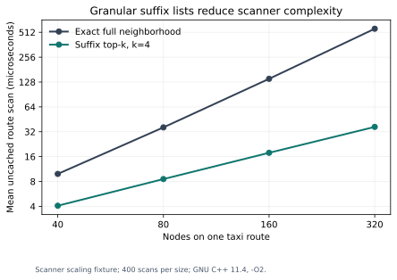

# Exact insertion caching and neighborhood cuts

The campaign uses `r240_p120_m120_s5`, seed 1, the default temperature 200 and
60,000 cooling iterations, with `--time-limit 300`. Only one full ALNS process
runs at a time, pinned to CPU 2. The source baseline includes the earlier fixed
insertion scratch and immutable request table. This is a single-instance,
single-seed diagnostic, not a multi-seed performance or robustness study.

## Directions tested

**ProfitInsertion.** A persistent `PositiveInsertionCache` stores an exact best
positive insertion for each request/taxi and each request's winning choice. Each
repair synchronizes stale cells against candidate route versions. After inserting
one request, it refreshes only that taxi for every remaining request. Other exact
cells stay valid; there are no threshold-drop rescans. Global request ties keep
the supplied pool order, and taxi/position ties keep the original traversal order.
Duplicate pool entries, state restoration, taxi activation/emptying and different
instance/index bindings are covered. The pool still includes every unserved
request. The no-index path remains available.

**AddRequest and ReplaceRequest.** AddRequest uses its own persistent positive
cache and the same changed-taxi update. ReplaceRequest retains its route-version
SMD descriptors and queue. Its insertion queries can have negative insertion
gain when removal savings make the complete replacement improve the objective;
the positive-only cache is therefore not used for replacement.

Exact best-only scans prune against the best gain instead of maintaining the
second-best threshold. The tested cost-order variant sorts delivery gaps and
stops when later gaps cannot improve the winner. It preserves equal-gain position
order explicitly, but sorting overhead can exceed the feasibility savings.
A linear variant retains ascending positions and the stronger best-only threshold.

The stronger exact-bound trial restricts the optimistic cost minimum to legal
boundaries and necessary pickup conditions. Before pickup at gap `a`, the original
prefix is unchanged. Its cached earliest departure and cumulative parcel load
therefore give necessary conditions:

```
departure_before_a + time(previous_node, pickup) <= pickup_latest + 1e-8
load_before_a + incoming_weight <= taxi_capacity + 1e-8
```

These are only rejection bounds. The existing complete route feasibility test
still checks waiting, all windows, loads and the suffix. They remain valid on a
removal-only replacement route that is infeasible: insertion cannot change nodes
before its pickup. No metric or symmetric-distance assumption is introduced.

For a parcel, the exact insertion cost is adjacent cost `A[a]` or, for `a < b`,
`P[a] + D[b]`. The route lower bound uses eligible pickup gaps and allowed delivery
gaps. Its suffix delivery minima also exclude forbidden boundaries. If even this
optimistic cost cannot beat the supplied gain threshold, the route/pickup is cut.

**Granular neighborhoods.** Experimental `k=2,4,8` variants inspect at most k
cheapest separated delivery gaps after each pickup, while retaining adjacent
insertions. They restrict AddRequest and ReplaceRequest; ProfitInsertion stays
exact. This bounds expensive feasibility evaluations per parcel pickup, but the
implemented ordered-list traversal can still be quadratic when skipping delivery
gaps preceding the pickup. It does not establish a lower worst-case bound for the
entire operator.

The `k=2` r240 trajectory changed. All three variants are rejected as defaults:
a dedicated witness has eight cheaper delivery gaps that violate the incoming
parcel's delivery window. The expensive feasible gap gives insertion gain 79;
an unguarded top-k restriction misses it. The exact AddRequest reaches benefit
1059 on this witness. Matching r240 final objectives alone cannot justify this
quality risk.

## Evidence and validation

The initial baseline, ProfitInsertion, sorted-bound and AddRequest-cache trials
all reached benefit 13279, completed all 60,000 iterations and matched all 60,001
progress records and final solution bytes. The independent public full evaluator
checked each final solution. Initial raw seconds were 195.109766, 169.849713,
179.630641 and 152.196749 respectively. Compilations overlapped portions of the
initial trials, and the disk interruption occurred during preparation; those
raw comparisons are diagnostic. A fresh final comparison is required before
reporting the retained implementation's runtime reduction.

On 200 matched partial states derived from the supplied r240 best-known solution,
seed 1, exact ProfitInsertion and AddRequest outputs had the same state hashes
as baseline. Incremental caches plus sorted best-only bounds reduced full
candidate feasibility checks from 3,061,592 to 892,650 for ProfitInsertion and
3,060,300 to 891,444 for AddRequest, approximately 71%. ReplaceRequest checks fell
from 103,269 to 101,089 in this workload. These are instrumented fixed-work counts,
not complete-ALNS speed measurements or an order-of-magnitude saving.

The final report, matched timings, compiler commands, source archives/hashes,
baseline-relative patches, checker results, complete logs and experimental
variants are in `results/diagnostics/speed-campaign-20261005`. `/results/` and
`/tests/` are ignored by this checkout, so the saved patch includes the tests.
Temporary duplicate build trees are removed after their binaries/metadata and
source evidence are retained.

## Corrected granular complexity and retained mechanism

The first granular implementation still walked a sorted delivery list to skip
positions before each pickup. It reduced expensive feasibility checks but retained
quadratic traversal, so it did not implement the requested order reduction.
The corrected experimental `suffix-k2`, `suffix-k4` and `suffix-k8` variants build
top-k delivery lists for every suffix. A backward pass maintains a bounded sorted
list, inserts each newly eligible delivery in O(k), and copies at most k entries
per pickup gap. Candidate evaluation then visits at most k separated deliveries
plus the adjacent case per pickup. Cost preparation and suffix minima take O(L);
top-k preparation and candidate visits take O(kL), with one fixed scratch allocation.
Here L is one taxi route's length, not the total instance request count.

On the isolated long-route fixture, every pickup prefix is feasible but every
completed delivery is late. The exact scanner therefore performs `(m+1)(m+2)/2`
full candidate checks for m passengers. The restricted scanner performs at most
`(k+1)(m+1) - k(k+1)/2` for `m >= k`. In four increasing route sizes, doubling L
roughly quadruples exact runtime and doubles the suffix-k runtime. At 320 nodes,
the k=4 scanner took 0.014657 seconds for 400 scans versus 0.226229 seconds for the
exact scanner (about 15.4x faster). These fixture timings isolate scan complexity;
they are not a whole-solver speed claim.



The corrected implementation still fails the quality witness: all three caps
return insertion gain 49 and AddRequest benefit 1029, against exact gain 79 and
benefit 1059. Correcting complexity does not make the omitted candidates safe.

The selected solver retains incremental positive caches for ProfitInsertion and
AddRequest, and best-only gain pruning in ascending position order. Sorting and
the additional pickup-eligibility bounds were tested and retired because they
added runtime in r240. The linear trial took 142.046155 seconds versus 149.132241
for the stronger prefix-bound trial, with identical progress and final solutions.
The original 15,424-byte scratch is restored. Each positive cache uses one fixed
282,240-byte allocation for r240 (including its request winners), with no cache
allocation during repeated prepare/refresh calls. The unchanged immutable request
table uses 44,160 bytes. Final workspace source, production build, independent
neighborhood witness, allocation checks and sanitizers have been validated.

## Final confirmation

The fresh sequential comparison completed all 60,000 iterations in
**185.12 seconds for baseline and 139.49 seconds for final**:
**24.65% less runtime**, or
1.327x throughput. Both reached benefit 13279;
full stderr matched after removing timing, all 60,001 progress records matched,
and final solution bytes were identical. Each final solution passed the baseline
public full evaluator. This is one seed and one fresh pair on a shared machine,
not an estimate of runtime variance or multi-seed robustness.

The final instrumented profile took 139.952 seconds. ReplaceRequest now accounts
for 36.861 seconds (26.34%), AddRequest 31.183 seconds (22.28%), ProfitInsertion
21.234 seconds (15.17%) and GreedyInsertion 27.619 seconds (19.73%). Local search
inclusive is 63.32%; do not add it to the individual move rows. Profile solution
bytes and full stderr excluding timing match the uninstrumented final run.

The production binary is rebuilt and source hashes match the final archived
source. Validation passed 13/13 production tests (including MIP), 12/12 isolated
no-CPLEX tests, and 7/7 ASan/UBSan checks. The detailed seed-level ablations,
restricted-neighborhood witnesses, corrected scaling results and provenance are
in the campaign report (`results/diagnostics/speed-campaign-20261005/report.md`).

Run the retained solver with:

```bash
./cmake-build-debug/SoICT2026 solve-alns --instance data/probation/r240_p120_m120_s5.txt --seed 1 --time-limit 300 > /tmp/r240-speed.sol
```

The configured temperature remains 200. Submission artifacts were not regenerated.
Temporary builds are removed after preserving source archives, hashes, compiler
commands, baseline-relative patches, all run/check/test logs and the plots.
